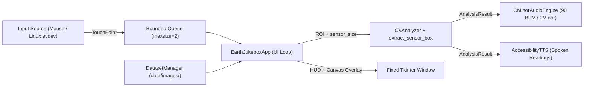

# Architecture & Linux Hardware Integration

Earth Jukebox is structured as a modular `src/` Python package (`earth_jukebox`) with clean boundaries between input hardware, NASA dataset management, computer vision, C-minor audio synthesis, text-to-speech accessibility, and the desktop Tkinter interface.

---

## Package Breakdown (`src/earth_jukebox/`)

| Module | Responsibility | Key Symbols |
| :--- | :--- | :--- |
| `models.py` | Immutable shared data contracts across all layers | `TouchPoint`, `AnalysisResult`, `DatasetEntry` |
| `input/` | Abstract input stream, bounded queue helper, mouse & Linux `evdev` drivers | `CoordinateInputSource`, `push_latest_point`, `WindowsMouseInputProxy`, `EvdevTrackpadInputProxy`, `find_touchpad`, `read_touchpad` |
| `datasets/` | Discovers NASA imagery, normalizes oversized frames, caches BGR arrays, binds metadata | `DatasetManager`, `catalog.json` |
| `vision/` | Edge-safe sensor patch cropping and morphological/color feature extraction | `extract_sensor_box`, `CVAnalyzer` |
| `audio/` | C Natural Minor scale/chord theory, cross-platform MIDI/synth backends, 90 BPM sequencer | `CMinorAudioEngine`, `AudioBackend`, `PygameMidiBackend`, `WinmmMidiBackend`, `LinuxFluidSynthBackend`, `PygameMixerSynthBackend`, `NullAudioBackend`, `create_best_audio_backend` |
| `accessibility/` | Non-blocking, interruptible speech worker with OS fallbacks | `AccessibilityTTS` |
| `ui/` | Fixed-size (`992x770`) non-wobbling Tkinter canvas, HUD telemetry, scroll/keyboard controls | `EarthJukeboxApp` |
| `cli.py` & `__main__.py` | Argument parsing (`--input`, `--device`, `--no-audio`, `--no-drums`, `--no-tts`, `--self-test`) and app startup | `parse_args`, `run_self_test`, `main` |

Outside the package, `tools/trackpad_monitor.py` provides a standalone raw coordinate monitor for inspecting Linux `evdev` trackpad streams prior to launching the main sonifier.

---

## Shared Data Contracts (`models.py`)

All runtime subsystems communicate using frozen dataclasses:

1. **`TouchPoint`**:
   - `x: int`, `y: int`: Raw pointer or trackpad integer coordinates.
   - `x_ratio: float`, `y_ratio: float`: Normalized `[0.0, 1.0]` coordinates across the active canvas or trackpad surface.
   - `touching: bool`: Whether a finger or pointer is actively engaging the map.
2. **`AnalysisResult`**:
   - `dominant_color: str`: One of `Black`, `White`, `Red`, `Orange`, `Green`, `Blue`.
   - `intensity: float`: Normalized `[0.0, 1.0]` luminance/saturation strength.
   - `density: float`: Normalized `[0.0, 1.0]` Canny edge density.
   - `shape: str`, `shape_score: float`: Spatial morphology (`uniform`, `linear`, `circular`, `organic`) and confidence `[0.0, 1.0]`.
   - `spottiness: float`: Normalized `[0.0, 1.0]` fragmented multi-spot activity.
   - `swirliness: float`: Normalized `[0.0, 1.0]` directional curl / rotational gradient spread.
   - `sensor_size: int`: Active square sensor box width/height in pixels (`16` to `160`, default `40`).
   - `sensor_bbox: tuple[int, int, int, int]`, `cursor_xy: tuple[int, int]`, `touching: bool`.
3. **`DatasetEntry`**:
   - `name`, `path`, `category`, `unit`, `summary`, `color_meanings`, and `meaning_for(color)` helper.

---

## End-to-End Data Flow

```text
+-------------------------------------------------------------------+
| Input Layer (Thread / Event Loop)                                 |
|   WindowsMouseInputProxy  OR  EvdevTrackpadInputProxy             |
|        (Desktop Mouse)          (3D Map over Linux Trackpad)      |
+---------------------------------+---------------------------------+
                                  |
                                  | TouchPoint(x, y, x_ratio, y_ratio, touching)
                                  v  via bounded queue.Queue(maxsize=2)
+-------------------------------------------------------------------+
| UI & Frame Coordinator (EarthJukeboxApp)                          |
|   - Polls queue at ~60 Hz (or steps Auto-Scan Jukebox mode [P])   |
|   - Maps normalized ratios -> image coordinates                   |
|   - Resizes sensor_size via [+]/[-] or Scroll Wheel (16..160 px)  |
+---------------------------------+---------------------------------+
                                  |
                                  v
+-------------------------------------------------------------------+
| Computer Vision Layer (vision/)                                   |
|   extract_sensor_box(image, img_x, img_y, box_size=sensor_size)   |
|     -> CVAnalyzer.analyze_patch(...)                              |
|     -> AnalysisResult(color, intensity, density, shape,           |
|                       spottiness, swirliness, sensor_size, ...)   |
+-----------------+-------------------------------+-----------------+
                  |                               |
                  | update_analysis()             | [R] / [I] / [Space]
                  v                               v
+-----------------------------------+   +---------------------------+
| Audio Engine (audio/)             |   | Accessibility TTS         |
|   CMinorAudioEngine (90 BPM clock)|   |   AccessibilityTTS        |
|   - Veridis Quo 8-bar C-minor bed |   |   - pyttsx3               |
|   - Adaptive melody & arpeggio    |   |   - Windows System.Speech |
|   - Channel 9 ambient drums [D]   |   |   - Linux spd-say/espeak  |
+-----------------------------------+   +---------------------------+
```



### Bounded Queue Semantics

Input drivers push coordinates through `push_latest_point(points_queue, point)` on a `queue.Queue(maxsize=2)`. When the queue is full, the oldest unconsumed `TouchPoint` is dropped before inserting the newest frame. This prevents pointer lag or queued backlog during rapid finger motion across the tactile map.

---

## Cross-Platform Design (Linux & Windows)

- **Lazy Platform Imports**: Windows-specific APIs (`ctypes.windll`, `ctypes.wintypes`) are imported lazily inside `WinmmMidiBackend` only on Windows. Linux `evdev` is imported lazily inside `evdev_trackpad.py`, and `tkinter` is kept isolated from headless core modules (`models`, `vision`, `datasets`, `audio`, `accessibility`, `input`).
- **Fixed Non-Wobbling Window**: `EarthJukeboxApp` locks window dimensions (`resizable(False, False)` with `pack_propagate(False)` on header, science summary, telemetry HUD, and shortcut bars) so switching between NASA datasets with different summary lengths never shifts the canvas under the user's cursor.
- **Cross-Platform Input & Scroll Events**: Binds both Windows/macOS `<MouseWheel>` and Linux X11 `<Button-4>` / `<Button-5>` events for cursor box resizing (`16` to `160` px in `8` px steps), alongside keyboard shortcuts (`+`, `=`, `-`, `_`, `[`, `]`).
- **TTS Backends**: `AccessibilityTTS` prefers `pyttsx3` when available with working voices, falling back automatically to Windows `System.Speech` via PowerShell, Linux `spd-say` / `espeak`, or console output in headless environments.

---

## Step-by-Step Linux `evdev` Hardware Integration Guide

Use this workflow to run Earth Jukebox with the 3D-printed tactile map mounted directly over a Linux laptop trackpad.

### Step 1: Print and Mount the Tactile Map

1. Slice and 3D-print `hardware/tactile-map/world-map.3mf` (or `hardware/tactile-map/world-map.stl`).
2. Align and mount the tactile plate cleanly over the physical laptop trackpad so continent reliefs correspond to the trackpad's active capacitive area.
3. Keep the print thin enough (or use conductive/capacitive-friendly contact or light fingertip pressure) so your laptop touchpad still registers touch coordinates underneath.

### Step 2: Install Python & System Dependencies

Install Earth Jukebox with Linux `evdev`, audio, and TTS dependencies:

```bash
pip install -e ".[linux,midi,tts]"
```

On Debian/Ubuntu-based distributions, ensure Tkinter and speech synthesis utilities are installed if not already present:

```bash
sudo apt-get update
sudo apt-get install -y python3-tk speech-dispatcher espeak fluidsynth
```

### Step 3: Grant Read Access to `/dev/input/event*`

Linux restricts raw `/dev/input/event*` devices to root and members of the `input` group. Add your user to `input`:

```bash
sudo usermod -aG input "$USER"
```

Log out and log back in (or reboot) for group membership to take effect. Verify permissions with:

```bash
ls -l /dev/input/event*
groups
```

### Step 4: Identify and Test the Raw Touchpad Device

Laptop touchpads often expose multiple kernel interfaces (a relative mouse interface and an absolute `EV_ABS` touchpad interface). Earth Jukebox requires the raw absolute touchpad device (`ABS_X`/`ABS_Y` or `ABS_MT_POSITION_X`/`ABS_MT_POSITION_Y`).

Run the standalone trackpad diagnostic tool:

```bash
python3 tools/trackpad_monitor.py
```

- If multiple touchpads are detected, list your devices (e.g., via `python3 -m evdev.evtest` or `cat /proc/bus/input/devices`) and pass the raw touchpad node explicitly:

```bash
python3 tools/trackpad_monitor.py --device /dev/input/event7
```

Move a finger across the tactile map and verify that `x`, `y`, and touching/not-touching states update smoothly in real time.

### Step 5: Launch Earth Jukebox in `evdev` Mode

Start the full sonification interface reading directly from the trackpad:

```bash
earth-jukebox --input evdev
```

Or specify the exact event node:

```bash
earth-jukebox --input evdev --device /dev/input/event7
```

- Press `[Space]` to hear the Audio Legend.
- Use `[Tab]` or `[1]`-`[8]` to switch between the 7 NASA EIC datasets and the `World Topography and Bathymetry` tactile reference map (`8`).
- Use `[+]` / `[-]` (or `[Scroll]`) to adjust the sensor box size (`16` to `160` px) for fine coastal details versus broad continental or ocean regions.
